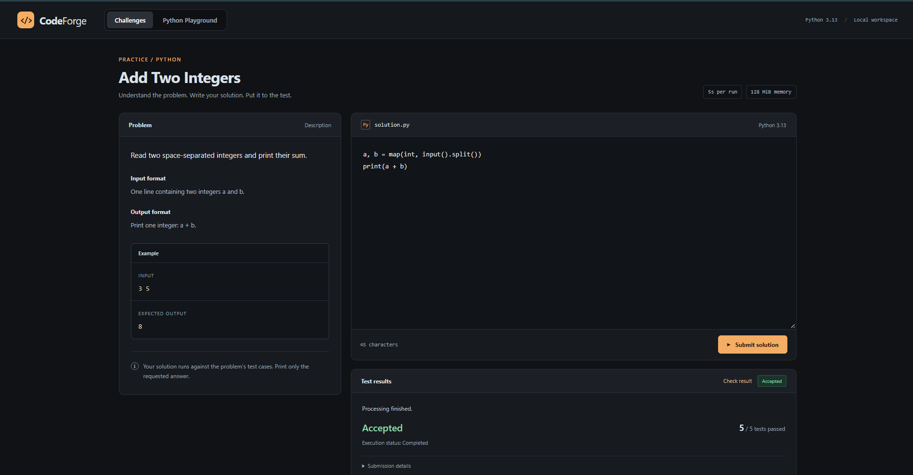
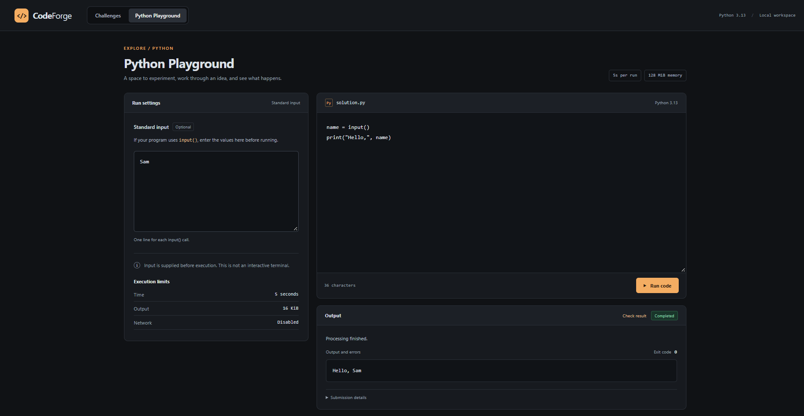

# CodeForge

A Python coding-challenge platform and Playground built with React, FastAPI,
and PostgreSQL. Local execution uses Redis and Docker; hosted execution uses
Vercel Queues and Vercel Sandbox with Neon PostgreSQL.

Users read a problem, submit a Python solution, and see a verdict and test
counts. The current problem is **Add Two Integers**, with five test cases.
The API also supports running code without selecting a problem.

## How local execution works

1. React loads the problem description from FastAPI.
2. FastAPI validates the submission and commits it to PostgreSQL.
3. FastAPI puts its UUID into a Redis list.
4. A Python worker removes the UUID and claims the database record.
5. For a problem submission, the judge runs each test in a separate Docker
   container and compares the output with the expected answer.
6. The worker saves the result in PostgreSQL.
7. React polls the API until processing finishes or its checking limit is reached.

PostgreSQL stores submissions and results. Redis coordinates pending work.
Execution happens in the worker, outside the API request.

## Features

- Python submissions validated to contain 1–10,000 characters.
- Persistent submissions identified by UUID.
- Background execution and automatic result polling.
- Accepted, Wrong Answer, Runtime Error, Timeout, and Output Limit outcomes.
- Server-side test cases omitted from public problem responses.
- Conditional database updates to claim only received submissions.
- Manual recovery for eligible received/running submissions.
- Separate Challenges and Python Playground sections.
- Playground runs accept optional standard input and display combined output/errors and exit codes.
- Input is supplied before execution; the Playground is not an interactive terminal.

`completed` describes successful execution; `accepted` describes correctness.
A completed program can receive `wrong_answer`.

The judge stops at the first failure. Test counts report cases passed before
that failure. Comparisons strip surrounding whitespace. For judged submissions,
output and exit code are null because the current judge returns aggregate results.
Raw-run submissions return combined output and an exit code.

## Local execution restrictions

The runner uses `python:3.13-slim` with:

- Disabled container networking and a read-only root filesystem.
- A non-root user, dropped Linux capabilities, and no new privileges.
- 128 MiB memory, no additional swap allowance, 0.5 CPU quota, and 32 PID limit.
- Five-second program timeout, with a one-second force-kill grace period.
- A separate 60-second Docker execution deadline, followed by bounded cleanup waits.
- 16 KiB input limit and 16 KiB combined raw stdout/stderr capture limit.
- Disabled Docker log storage and explicit container removal.

These are prototype restrictions, not a security certification or a complete
boundary for hostile public workloads. The host worker has Docker access.
Submitted containers receive no host mounts or Docker socket.

## Local setup on Windows

Prerequisites:

- Python (developed with Python 3.14).
- Node.js and npm (developed with Node.js 24).
- Git.
- Docker Desktop running Linux containers with WSL 2.

Run these commands in PowerShell from your checkout's CodeForge root directory,
one at a time. This project uses a Python virtual environment explicitly, so
activation is optional.

### 1. Configuration and dependencies

For a new checkout, copy the example configuration:

```powershell
Copy-Item .env.example .env
```

Do not overwrite an existing configured `.env`. Edit the new file and replace
the password placeholder. Keep `.env` out of Git. The commands below assume
the example database name and user are both `codeforge`.

```powershell
py -m venv .venv
.\.venv\Scripts\python.exe -m pip install -r requirements.txt
npm.cmd --prefix frontend ci
docker pull python:3.13-slim
```

The runner uses `--pull never`, so its image must already be downloaded.

### 2. Database and Redis

```powershell
docker compose up -d db redis
docker compose exec db pg_isready -U codeforge -d codeforge
docker compose exec redis redis-cli ping
```

Wait for PostgreSQL to accept connections; repeat the readiness check if needed.
Redis should return `PONG`.

For a **new database only**, create the base table:

```powershell
Get-Content -Raw schema.sql | docker compose exec -T db psql -U codeforge -d codeforge -v ON_ERROR_STOP=1
```

Skip that command if the table already exists. Then apply both migrations:

```powershell
.\.venv\Scripts\python.exe add_result_columns.py
.\.venv\Scripts\python.exe add_judging_columns.py
.\.venv\Scripts\python.exe add_stdin_column.py
```

The migrations use `ADD COLUMN IF NOT EXISTS` and can be rerun.

### 3. Run the application

Open three terminals, each in the CodeForge root.

Terminal 1 — API:

```powershell
.\.venv\Scripts\python.exe -m uvicorn main:app --reload
```

Terminal 2 — worker:

```powershell
.\.venv\Scripts\python.exe worker.py
```

Terminal 3 — frontend:

```powershell
npm.cmd --prefix frontend run dev
```

Keep all three running. Open the frontend's printed Local URL, normally
http://localhost:5173. API documentation is at http://127.0.0.1:8000/docs.

Vite forwards `/api` requests to FastAPI and removes the `/api` prefix.
That proxy is a development-server feature; a production build needs its own
API routing arrangement.

## Try it

Submit this solution in the webpage:

```python
a, b = map(int, input().split())
print(a + b)
```

Expected: `completed`, `accepted`, and `5 / 5`.

Additional examples:

| Code | Expected verdict |
|---|---|
| `print(999)` | `wrong_answer` |
| `raise ValueError('demo error')` | `runtime_error` |
| `import time; time.sleep(30)` | `timed_out` |
| `print('x' * 20000)` | `output_limit` |

## Checks

With Docker running and the runner image downloaded:

```powershell
.\.venv\Scripts\python.exe check_runner_cases.py
.\.venv\Scripts\python.exe check_output_limit.py
.\.venv\Scripts\python.exe check_runner_input.py
.\.venv\Scripts\python.exe check_judge.py
npm.cmd --prefix frontend run lint
npm.cmd --prefix frontend run build
```

Check leftover execution containers:

```powershell
docker ps -a --filter "name=codeforge-run-" --format "{{.Names}}"
```

No names should appear when no execution is in progress.

During development, the five outcomes above were exercised through the webpage.
API downtime/recovery and restarting the existing installation were also checked.
Lint and frontend build passed. Installation on a separate clean computer and
public deployment have not been verified.

## Shutdown and recovery

Wait for active work to finish, then press Ctrl+C in each application terminal.
If npm asks `Terminate batch job (Y/N)?`, enter `Y`.

```powershell
docker compose stop
```

Named volumes preserve database and Redis data. Restart with `docker compose up
-d db redis` and the three application commands.

If a submission is stranded, stop **all workers** before manual recovery.
Ensure PostgreSQL and Redis are running. Replace `YOUR_ID` below:

```powershell
.\.venv\Scripts\python.exe recover_submission.py YOUR_ID --workers-stopped
```

Then restart one worker. The flag acknowledges that workers are stopped; it does
not verify that condition. Recovery can re-execute a submission.

## Limitations and future work

- This is a local prototype with one Python problem, not a public hosted service.
- No authentication, per-user quotas, rate limiting, or production deployment.
- Database commits and Redis enqueue operations are separate. HTTP 503 can include
  a saved ID when queue delivery is uncertain; blindly resubmitting can duplicate work.
- Redis list removal has no acknowledgment. A worker crash can strand a job.
  Automatic recovery and crash-during-execution recovery are not verified.
- A host or worker crash can leave containers behind; cleanup is not guaranteed
  across host failure.
- Exit-code-based classification has limits: submitted code can choose exit codes,
  and code 137 does not uniquely identify an out-of-memory condition.
- stdout and stderr are combined. Separate streams and richer test diagnostics
  are future improvements. The output cap applies to captured bytes before decoding.
- Problem definitions live in Python source; no problem-management UI or versioning.
- Polling results and editor contents are not persisted in the browser across reloads.
- Automated load, concurrency, and adversarial security testing remain future work.

## Key files

| File | Responsibility |
|---|---|
| `main.py` | API validation, submission storage, queue delivery, result retrieval |
| `database.py` | PostgreSQL connections |
| `worker.py` | Claiming submissions and persisting execution/judging results |
| `runner.py` | Container execution, input/output handling, limits, cleanup |
| `judge.py` | Test-case comparison and aggregate verdict |
| `problems.py` | Problem metadata and server-side cases |
| `schema.sql` and `add_*_columns.py` | Base schema and incremental migrations |
| `recover_submission.py` | Operator-assisted recovery |
| `frontend/src/App.jsx` | Editor, problem loading, submission, result polling |
| `frontend/vite.config.js` | Development API proxy |

## Screenshots

### Coding Challenges
Solve a Python challenge and see the verdict and test results.



### Python Playground
Run Python code with custom input and view the output.



## Hosted demo

The Vercel path requires a shared demo access code and limits submissions to
10 per rolling 24 hours and two per minute. It uses a private queue subscriber
and isolated cloud sandboxes; it does not depend on the developer's computer.
Cloud programs use a 128 MiB address-space limit, rather than Docker's physical
memory limit. The default Python image can change between provider releases.

See [Cloud deployment](CLOUD_DEPLOYMENT.md) for setup, SQL migration, execution
limits, failure behavior, and acceptance checks. Public problem descriptions
remain readable without an access code. This demo has shared access, not
individual accounts or a production multi-tenant authorization system.
